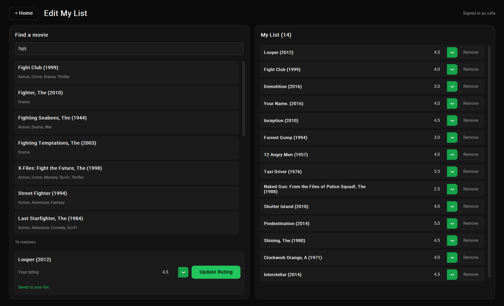

# CineMatch - Movie Recommender

CineMatch is a Python desktop application that recommends movies based on your ratings using two machine learning approaches: **Content-Based Filtering** and **Collaborative Filtering**.

## Screenshots

<p align="center">
  
  
</p>

## Features

- Modern dark GUI built with CustomTkinter
- Search movies by title and browse genres
- Add, rate, update, and remove movies
- Persistent user profiles stored as JSON
- Two recommendation algorithms with scores and explanations
- Recommends up to five movies you haven't rated
- Handles missing data and limited recommendation history

## Recommendation Algorithms

**Content-Based Filtering**
- Uses TF-IDF to represent movie genres.
- Builds a user preference profile from movie ratings.
- Recommends movies based on cosine similarity.

**Collaborative Filtering**
- Uses historical ratings to calculate movie similarities.
- Predicts preferences based on similar movies and user ratings.
- Skips movies without sufficient similarity data.

## Installation

```powershell
python -m venv .venv
.\.venv\Scripts\Activate.ps1
pip install -r requirements.txt
```

## Run

```powershell
python main.py
```

## Requirements

- pandas
- numpy
- scikit-learn
- customtkinter

## Workflow


## Limitations

- Users need to rate movies before receiving recommendations.
- Content-based recommendations rely on genres only.
- Collaborative filtering may return fewer than five movies when historical rating data is insufficient.
