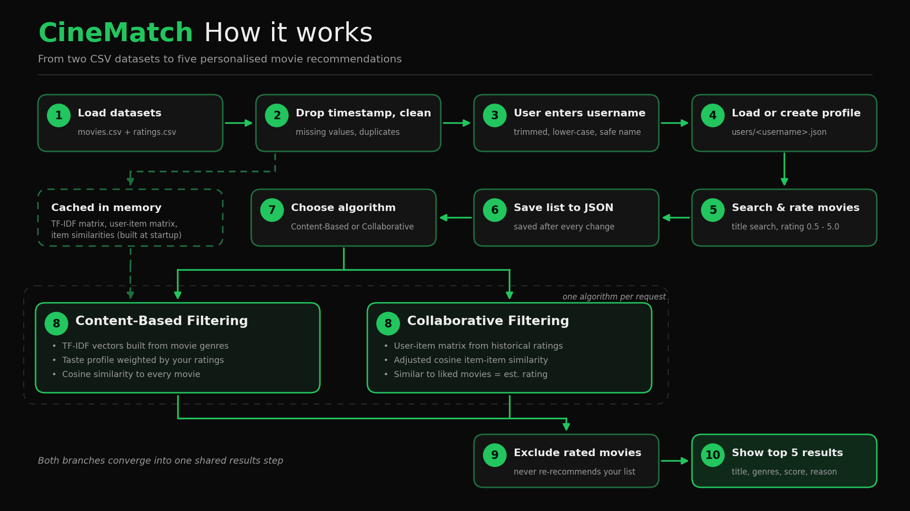

# 🎬 CineMatch - Movie Recommender

CineMatch is a Python desktop app that recommends movies based on your ratings. It offers two approaches — **Content-Based** and **Collaborative Filtering** — so you can explore and compare recommendations.

Built with Python, pandas, scikit-learn and CustomTkinter.

<p align="center">
  
  
</p>

## Features

- Two recommendation algorithms with scores and explanations.
- Rate, edit and remove movies from your personal list.
- Search movies by title.
- Individual user profiles stored in JSON files.
- Adjustable recommendation count (1–10).
- Dark and light themes.
- Built-in help guide.
- Copy recommended movie titles to clipboard.

## Algorithms

- **Content-Based:** Recommends movies based on genre similarity to your rated movies.
- **Collaborative Filtering:** Uses historical user ratings to find movies similar to those you liked.

Movies already in your list are excluded from recommendations.

## Installation

```powershell
git clone https://github.com/vafabara/CineMatch.git
cd CineMatch

pip install -r requirements.txt
python main.py
```

## Dataset

Uses two CSV files:

- `movies.csv` — Movie IDs, titles and genres.
- `ratings.csv` — Historical user ratings.

The datasets are read-only and cleaned when loaded.

## Project Structure

```text
Movie-Recommender/
├── main.py
├── recommender.py
├── movies.csv
├── ratings.csv
├── users/
├── assets/
│   ├── recommender.png
│   ├── list.png
│   └── workflow.png
├── README.md
└── requirements.txt
```

## Workflow

<p align="center">
  
</p>

## Limitations

- Recommendations require rated movies to understand your preferences.
- Content-Based filtering uses genres only.
- Collaborative Filtering depends on historical rating coverage and may return fewer results.

---

**Made with Python by [Vafa Bara](https://github.com/vafabara)**